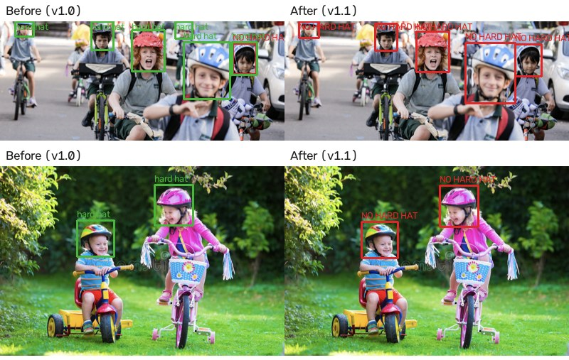
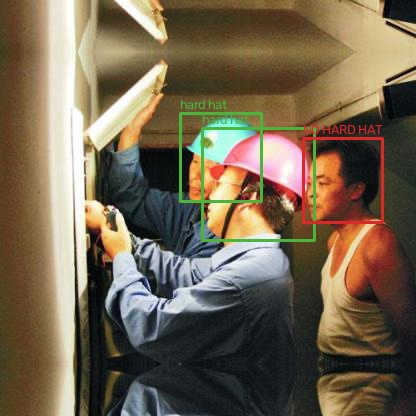

# AI-Based Helmet Monitoring & Face Recognition System

A real-time computer vision system that detects workers without hard hats and identifies who they are. A **YOLOv8** detector finds worker hard hats (of any colour) and heads without one, and doesn't accept bike helmets as PPE; **InsightFace** recognises faces, bounding-box spatial verification links each face to the right head, and a **FastAPI + WebSockets** backend streams results to a live web dashboard.

## How it works

```
 browser / camera                      FastAPI server
┌──────────────┐  JPEG frames   ┌──────────────────────────────────────────────────────┐
│  webcam page │ ─────────────► │ WebSocket ─► frame queue (drops oldest when busy)    │
│  (canvas     │                │                 │                                    │
│   overlay)   │ ◄───────────── │                 ▼  background thread                 │
└──────────────┘  JSON results  │   1. YOLOv8 ─────────► helmet / head boxes           │
                                │   2. spatial check ──► one state per head            │
                                │   3. InsightFace ────► faces + 512-d embeddings      │
                                │   4. face ↔ head ────► face centre inside head area  │
                                │   5. cosine match ───► worker identity or Unknown    │
                                │   6. tracker ────────► confirmed, rate-limited       │
                                │                        violations → SQLite + snapshot│
                                └──────────────────────────────────────────────────────┘
```

1. **Hard hat detection** ([`detection/detector.py`](helmet_monitor/detection/detector.py)): a YOLOv8 model trained on two classes. `helmet` is a head wearing a worker hard hat. `head` is a head without one, which includes heads wearing bike helmets.
2. **Spatial verification** ([`compliance/spatial.py`](helmet_monitor/compliance/spatial.py)):
   - When a `helmet` box and a `head` box overlap on the same person (IoU ≥ 0.5), only the more confident one is kept, so nobody counts as both compliant and violating.
   - A face is linked to a head only if the face's centre lies inside that head's region. The region is extended downwards, because a helmet box often covers the helmet more than the face. Matching is one-to-one, closest first.
3. **Face recognition** ([`recognition/`](helmet_monitor/recognition/)): InsightFace `buffalo_l` (RetinaFace detector + ArcFace) produces a 512-dimensional embedding. Embeddings are **L2-normalised**, so a matrix dot product gives the **cosine similarity** to every registered worker at once. Below the threshold (default 0.45), the person is `Unknown`.
4. **Violation tracking** ([`compliance/tracker.py`](helmet_monitor/compliance/tracker.py)):
   - A violation is recorded only after a person has been without a hard hat for **10 seconds** straight. The live view shows a countdown above their head.
   - Putting a hard hat on, or leaving the frame for more than 2 s, resets the timer. Shorter detection dropouts don't.
   - If a worker's face briefly isn't recognised (looking down, turned away), their bare head is matched to where they just were, so the time still counts for them.
   - After recording, the same worker isn't recorded again for 60 s.
5. **Async real-time backend** ([`streaming/session.py`](helmet_monitor/streaming/session.py), [`api/websocket.py`](helmet_monitor/api/websocket.py)):
   - Each camera gets its own WebSocket session. Receiving and processing run as separate asyncio tasks joined by a small queue.
   - Inference runs in a worker thread, so the event loop stays responsive.
   - When the models are slower than the camera, the oldest frame is dropped, so results always describe the present instead of falling behind.

## Results

YOLOv8s trained for 59 epochs (seed 42) on an RTX 5060 Laptop GPU, in 44 minutes, on two public datasets:

- [Hard Hat Detection](https://www.kaggle.com/datasets/andrewmvd/hard-hat-detection): 5,000 construction images. Its `helmet` boxes are worker hard hats.
- [Helmet Detection](https://www.kaggle.com/datasets/andrewmvd/helmet-detection): 764 motorbike images. Every rider's head, **with or without a bike helmet**, is labelled `head` (no hard hat).

Each dataset is split 70/20/10 into train/validation/test. All scores below are on the **held-out test split**, which was never used for training or for choosing the best epoch.

| Metric | Full test set (576 images, 2,753 heads) | Hard-hat images only (500 images) |
|---|---|---|
| **mAP@0.5** | **93.8%** | **95.6%** |
| **mAP@0.5:0.95** | **62.1%** | **63.3%** |
| Precision | 88.5% | 91.6% |
| Recall | 90.7% | 91.2% |

| Class | AP@0.5 | AP@0.5:0.95 |
|---|---|---|
| helmet (hard hat) | 96.6% | 64.0% |
| head (no hard hat) | 91.1% | 60.1% |

Inference: 5.2 ms per image on the RTX 5060.

### Bike helmets are not hard hats

A model trained on hard hats alone (v1.0) treats any helmet as PPE. Adding motorbike riders as negatives fixed that, with no loss on hard hats (95.5% → 95.6% mAP@0.5 on the same hard-hat test images):

| Test-split bike helmets (72 detected) | v1.0 (hard hats only) | **v1.1 (with bike negatives)** |
|---|---|---|
| Wrongly accepted as a hard hat | 93.1% | **4.2%** |
| Correctly flagged as no hard hat | 6.9% | **95.8%** |

<p align="center"></p>

<p align="center"></p>

Full reports: [`reports/detection_metrics.md`](reports/detection_metrics.md) and [`reports/bike_helmet_check.json`](reports/bike_helmet_check.json). Training curves, the precision–recall curve and the confusion matrix are in [`reports/figures/`](reports/figures/). To reproduce, see [Training the detector](#training-the-detector).

## Features

- Live webcam monitoring in the browser, with boxes, names, compliance counts and a 10-second violation countdown drawn over the video
- Worker registration from an uploaded photo **or a live camera capture**, with the face embedding stored in SQLite
- Violation log with annotated snapshots and a per-worker summary
- Several cameras at once, one WebSocket each, sharing one set of models
- REST API with interactive docs at `/docs`
- 72 automated tests that run in about 2 seconds, with no model downloads (models are replaced by fakes)

## Getting started

Requires Python 3.10+.

```bash
git clone https://github.com/HarshKnight2477/Helmet-Monitoring-Face-Recognition.git
cd Helmet-Monitoring-Face-Recognition
python -m venv .venv
.venv\Scripts\activate            # macOS/Linux: source .venv/bin/activate
pip install -r requirements.txt
```

1. Download the trained detector from the [latest release](https://github.com/HarshKnight2477/Helmet-Monitoring-Face-Recognition/releases/latest) and save it as `models/helmet_yolov8.pt`. Or train your own, as described below.
2. Start the server:
   ```bash
   uvicorn helmet_monitor.main:app --port 8000
   ```
3. Open http://localhost:8000:
   - **Workers:** register people by uploading a clear, front-facing photo, or with *Use camera* → *Capture*.
   - **Live monitor:** click *Start camera*.
   - **Violations:** review the log and snapshots.

The InsightFace model (~300 MB) downloads automatically on first start. `GET /api/health` reports whether both models loaded.

Settings such as thresholds, cooldown and file paths can be changed through environment variables; see [`.env.example`](.env.example).

### Docker

```bash
docker build -t helmet-monitor .
docker run -p 8000:8000 helmet-monitor
```

## Training the detector

[`training/helmet_yolov8_kaggle.ipynb`](training/helmet_yolov8_kaggle.ipynb) trains and evaluates the model on Kaggle's free GPU:

1. On Kaggle, create a notebook and choose *File → Import Notebook*, then upload the `.ipynb`.
2. *Add Input*: **Hard Hat Detection** and **Helmet Detection**, both by andrewmvd.
3. Set *Accelerator* to **GPU** and *Internet* to **On**, then click *Run All* (about 1–2 hours).
4. Download `helmet_yolov8.pt` into `models/` and unzip `reports.zip` into `reports/`.

With an NVIDIA GPU, the same steps run locally. The published model was trained this way. Install a CUDA build of PyTorch first ([pytorch.org](https://pytorch.org/get-started/locally/)), then:

```bash
pip install kagglehub
python -c "import kagglehub; print(kagglehub.dataset_download('andrewmvd/hard-hat-detection'))"
python -c "import kagglehub; print(kagglehub.dataset_download('andrewmvd/helmet-detection'))"
python training/prepare_dataset.py --annotations <hard-hat>/annotations <bike>/annotations --images <hard-hat>/images <bike>/images --output data/helmet-yolo
yolo detect train data=data/helmet-yolo/data.yaml model=yolov8s.pt epochs=60 imgsz=640 batch=16 patience=20 seed=42 hsv_h=0.05 project=runs name=helmet
python training/evaluate.py --weights runs/helmet/weights/best.pt --data data/helmet-yolo/data.yaml --split test
python training/check_bike_helmets.py --weights runs/helmet/weights/best.pt --annotations <bike>/annotations --images <bike>/images --manifest data/helmet-yolo/test_manifest.json
```

`prepare_dataset.py` converts VOC boxes to YOLO format and drops the `person` class. It relabels every motorbike head, with or without a helmet, as `head` (no hard hat), so the detector learns that a bike helmet is not PPE. Each dataset gets its own reproducible 70/20/10 split (seed 42). `hsv_h=0.05` adds stronger hue shifts during training, so hard hats of any colour are recognised.

## API

| Method | Path | Description |
|---|---|---|
| `GET` | `/api/health` | Model status, worker count, active cameras |
| `GET` | `/api/cameras` | Active camera sessions and frame stats |
| `GET` | `/api/workers` | List registered workers |
| `POST` | `/api/workers` | Register a worker (`name`, optional `email`, `photo`) |
| `DELETE` | `/api/workers/{id}` | Remove a worker |
| `GET` | `/api/violations` | Violation log (`limit`, `worker_id`) |
| `GET` | `/api/violations/summary` | Totals, today, top violators |
| `WS` | `/ws/monitor/{camera_id}` | Send JPEG frames (binary or base64 JSON), receive JSON results |

Other cameras can stream too: anything that can open a WebSocket and send JPEG bytes, such as a Python script reading an RTSP CCTV feed with OpenCV, works with the same endpoint.

## Project structure

```
helmet_monitor/
├── main.py              # FastAPI app factory
├── config.py            # settings from environment / .env
├── services.py          # loads models, database, gallery; records violations
├── domain.py            # Box, Detection, Face, Identity, FrameResult
├── detection/           # YOLOv8 helmet detector
├── recognition/         # InsightFace embedder, cosine-similarity gallery
├── compliance/          # spatial verification, frame analyzer, violation tracker
├── streaming/           # camera sessions (async queue), image codecs
├── storage/             # SQLite: workers + violations
├── api/                 # REST routes, WebSocket endpoint, schemas
└── static/              # web dashboard (HTML/CSS/JS)
training/
├── helmet_yolov8_kaggle.ipynb  # train + evaluate on Kaggle
├── prepare_dataset.py          # VOC → YOLO with train/val/test split
└── evaluate.py                 # mAP report on the test split
tests/                          # pytest suite
```

## Running tests

```bash
pip install -r requirements-dev.txt
python -m pytest
```

## Acknowledgments

The service design draws on [sushant1009/Helmet_Detection_Project](https://github.com/sushant1009/Helmet_Detection_Project) (MIT). Detector built on [Ultralytics YOLOv8](https://github.com/ultralytics/ultralytics), face recognition on [InsightFace](https://github.com/deepinsight/insightface), trained on the [Hard Hat Detection](https://www.kaggle.com/datasets/andrewmvd/hard-hat-detection) dataset.

## License

[MIT](LICENSE)
